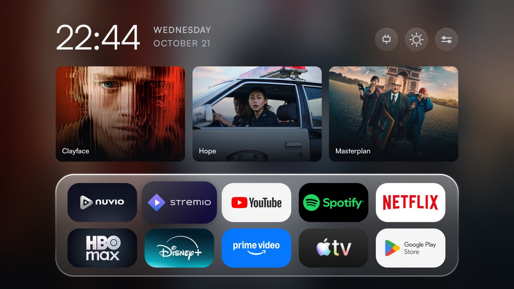
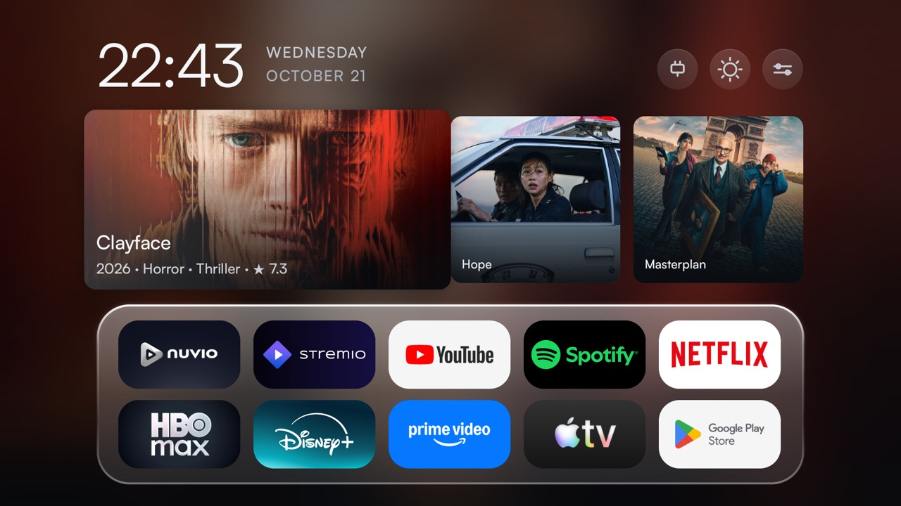
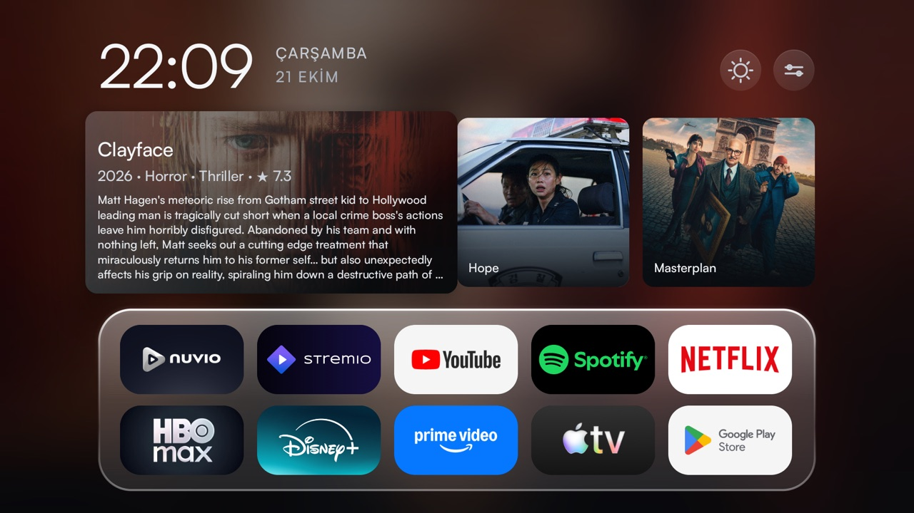
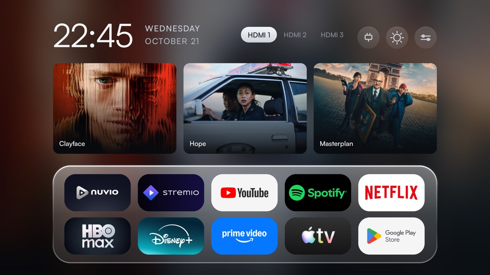

# Simplified TV

A calmer home screen for Android TV and Google TV: a glass dock with your apps, a row of the films
trending this week, and round buttons for options, settings and HDMI inputs. It also comes with an
optional debloat that switches off the TV maker's promo packages, nothing uninstalled.

<p>
  
  
  
  
</p>

Works on any Android TV or Google TV with ADB debugging, whatever the brand (Android 9 and newer).

## Install

First, on the TV: Settings → System → About, tap **Build** seven times; then Developer options →
turn on **USB debugging** and **Network debugging**. Find the TV's IP address in Settings → Network.

### Option 1: with Claude Code

```sh
git clone https://github.com/ruzgarselvan/simplified-tv
cd simplified-tv
claude
```

Then tell it: **"Install Simplified TV on my TV at 192.168.1.50."** Claude Code reads
[`AGENTS.md`](AGENTS.md), installs what is missing (adb, a JDK, the Android SDK), builds the app,
asks before it changes anything on the TV, and never prints your TMDB token.

### Option 2: by hand

You need `adb`, a JDK 17 and the Android SDK (`platforms;android-28`, `build-tools`):

```sh
brew install openjdk@17 android-platform-tools
brew install --cask android-commandlinetools
sdkmanager "platforms;android-28" "build-tools;34.0.0"
```

```sh
adb connect <tv-ip>:5555                  # accept "Allow USB debugging?" on the TV, tick "Always allow"
TMDB_TOKEN=<read access token> ./launcher/install.sh
```

`install.sh` builds the app, installs it and makes it the home screen. The TMDB token is optional: it
is a free *API Read Access Token* from themoviedb.org (Settings → API) and fills the movies row;
without it the row is simply not shown. It is stored on the TV only, never in the app or this repo.
On Linux set `JAVA_HOME` and `ANDROID_HOME`. Keep `launcher/release.keystore`: updates must be signed
with the same key.

## Languages

**Options → Language**: *System* (follows the TV), *Türkçe* or *English*. The choice also sets the
language of the movie titles, genres and summaries (a film with no Turkish translation falls back to
English).

## Debloat (optional)

```sh
./scripts/discover.sh               # read-only: what is on this TV, and what could go
./scripts/debloat.sh --dry-run      # what would be switched off, and what is protected
./scripts/debloat.sh                # asks, then does it
```

Only packages listed in `data/androidtv/packages.txt` are touched, and only disabled for the user.
Anything essential (the framework, TV input and tuner stack, remote and Bluetooth, home screens,
setup, installers), anything that holds the home screen or the keyboard, and anything that owns saved
Wi-Fi networks is skipped. If the TV ends up without a home screen, it is restored at once.

## Undo

`./scripts/restore.sh` turns the disabled packages back on. `./launcher/install.sh --undo` gives the
home screen back to the TV's own (and switches that on if it had been off).
`adb uninstall tv.dumbtv.home` removes the app.

## Credits

MIT. Forked from [humblemuzzu/dumbtv](https://github.com/humblemuzzu/dumbtv) and cut down to Android
TV and Google TV. Movie data and images come from [TMDB](https://www.themoviedb.org); this product uses
the TMDB API but is not endorsed or certified by TMDB.
